# Nightingale AI 开发工作流

一个可验收任务对应一个分支和一个 Paseo worktree，由一个主要 Agent 负责实现。
人负责目标、产品取舍和体验验收；Agent 负责调查、实现、工程检查和可追溯预览。

## 生命周期总览

下图只展示正常交付主线，节点前缀与颜色表示责任归属。失败恢复、暂停和取消
统一在图后说明，具体命令与证据要求放在各阶段正文中。
程序包括 Paseo、验证脚本、Git hooks、CI、预览管理器和发布工具；由人或 Agent
发起操作，按固定规则执行并返回结果。
可将 Mermaid 代码块复制到 [Mermaid Live Editor](https://mermaid.live/) 编辑和导出。

| 角色 | 在生命周期中的作用 | 必须留下的结果 |
| --- | --- | --- |
| 人（黄色） | 定义目标与验收标准，决定产品取舍；在运行实例上验收，审查并授权合并、发布；决定暂停、取消和后续任务 | 明确的任务范围、授权、人工验收结论及反馈 |
| Agent（蓝色） | 调查调用链，实施与修复，调用检查和预览，核对结果并收集证据；按授权提交、推送和交付，保留数据并核实清理 | 代码与测试、检查结果、预览 build ID、验收路径、PR 和交接记录 |
| 程序（绿色） | 创建或管理 worktree，执行构建、测试和门禁；维护隔离预览与构建身份，执行已授权的合并、发布及资源清理 | 可核对的退出码、日志、产物、探测结果和资源状态 |

```mermaid
flowchart TB
    subgraph Prepare["1. 准备任务与环境"]
        H_goal["人：明确目标与验收标准"]:::human
        A_plan["Agent：调查并明确方案与授权"]:::agent
        P_setup["程序：准备 worktree 与依赖"]:::program
        H_goal --> A_plan --> P_setup
    end

    subgraph Iterate["2. 实现、本地验证与预览验收"]
        A_work["Agent：实现与行为测试"]:::agent
        P_verify{"程序：本地检查通过？"}:::program
        P_preview["程序：准备或刷新预览"]:::program
        A_evidence["Agent：核验版本、浏览器检查与取证"]:::agent
        H_accept{"人：运行实例验收通过？"}:::human
        A_work --> P_verify
        P_verify -->|通过| P_preview --> A_evidence --> H_accept
    end

    subgraph Deliver["3. PR、审查与合并"]
        A_push["Agent：按授权提交并发起推送"]:::agent
        P_push{"程序：pre-push 通过？"}:::program
        A_pr["Agent：创建或更新 PR，附验收证据"]:::agent
        P_ci{"程序：CI 与 evidence 门禁通过？"}:::program
        H_review{"人：审查通过且合并已授权？"}:::human
        P_merge["程序：执行合并"]:::program
        A_push --> P_push
        P_push -->|通过后完成推送| A_pr --> P_ci
        P_ci -->|通过| H_review
        H_review -->|通过且已授权| P_merge
    end

    subgraph Finish["4. 交付与关闭"]
        A_release["Agent：按授权准备发布与恢复方案"]:::agent
        P_release{"程序：发布与部署核验通过？"}:::program
        A_handover["Agent：交接结果，保存成果与证据"]:::agent
        P_cleanup["程序：清理资源后归档"]:::program
        H_close["人：核对交付并关闭任务"]:::human
        A_release --> P_release
        P_release -->|通过| A_handover
        A_handover --> P_cleanup --> H_close
    end

    P_setup --> A_work
    H_accept -->|通过| A_push
    P_merge -->|本任务不含发布| A_handover
    P_merge -->|发布已获授权| A_release

    classDef human fill:#fff3cd,stroke:#a16207,color:#422006
    classDef agent fill:#e0f2fe,stroke:#0369a1,color:#0c4a6e
    classDef program fill:#dcfce7,stroke:#15803d,color:#14532d
```



先在本地完成检查和人工验收，再按授权推送、创建 PR；推送须通过 pre-push hook，
先过滤本地可发现的问题，减少无效推送和 CI 消耗。CI 保留为远端统一验证，不能用
本地通过记录替代。沿用会话中已有的明确授权；仅在目标、产品取舍或操作权限不足时
补充确认。程序不会自动作出产品取舍，Agent 也不能代填人工验收。

失败或反馈由 Agent 定位问题，返回对应步骤：代码问题回到实现，环境问题回到环境
准备或预览，证据问题补齐记录。处理后从失败的原始入口重跑，不能跳过或临时替换
pre-push / CI 来取得通过结果。测试使用临时 Git 仓库时必须隔离继承的仓库环境，
确保检查过程不改变任务仓库。任何代码或前端修改都重新执行相关检查，刷新预览并
核对 build ID，补验受影响路径；旧版本的通过记录不代表新版本已验收。

发布是独立的授权动作，合并不会自动更新稳定实例。具体发布、部署和恢复命令取决于
交付方式；当前预览脚本只管理实例生命周期。更新稳定实例仍须从配置的干净 main
checkout 构建，分支只使用 dev 槽位。发布失败时，Agent 记录失败，按授权发起回退或
恢复并核验；恢复失败时任务保持未完成，继续排障。恢复成功后，由人确认继续本次
发布还是移交后续任务。已回退且移交后续修复时，交接须明确“本次发布未完成”，并
关联可追踪的后续任务。

暂停和取消作为各阶段的旁路：人决定暂停后，Agent 保存进度、检查结果及恢复入口，
程序执行 stop，保留槽位与实例数据；失败时排障并重试。恢复时 Agent 核对当前环境
与已有结果，返回对应步骤；取消时转入交接与清理。暂停不代表任务完成，后续缺陷或
新需求在关闭后建立新任务。

闭环交付要同时具备：任务结果与人工结论、最终版本对应的工程检查和预览证据、
明确的剩余事项归属，以及归档前的资源清理结果。先保存代码、所需数据和证据，再
执行 teardown / destroy。Agent 核实进程退出、实例数据清理、槽位释放及交接证据已
保存后，程序再归档 worktree；清理失败时保留源码与登记信息，排障后从清理入口重试。
各阶段操作细节见下文和[预览运行手册](worktree-preview.md)。

## 开始任务

先读 [README](../README_zh.md)、[AGENTS.md](../AGENTS.md)、
[架构地图](../CLAUDE.md)，再读目标实现和 `doc/api/` 文档。
新主机按[环境准备](development-environment.md)操作。
本次设施实施的实际检查、基线失败和未验证范围见[验证记录](agent-workflow-validation.md)。

```bash
git status --short
git branch --show-current
git log -5 --oneline
go version
python3 --version
```

任务描述包含场景、期望行为、范围和可观察的验收步骤。简单修改直接实施；跨模块、
跨仓库或迁移任务先明确顺序和验收点。保留已有修改归属，记录基线失败。
Paseo setup 只配置 hooks，install 下载 Go 模块，预览按需构建。

## 实施与检查

沿调用链确认 UI/API、models、memsto、center/edge 和数据源边界。公开入口可能被
n9e-plus 使用；优先扩展字段或 setter，保持签名兼容。

| 范围 | 验证重点 |
| --- | --- |
| 路由/models | 鉴权、业务组权限、失败路径；edge/alert 远程读取 |
| Schema | gorm、初始化/迁移 SQL；MySQL/PostgreSQL/SQLite 差异 |
| 告警/通知 | 判断、恢复、屏蔽、派发；测试接收端，避免真实通知 |
| 集成模板 | action 检查、全部 en_US 渲染检查 |
| MCP/A2A/AI | 身份作用域、读写边界、流式取消；真实模型单独验收 |
| Skill 脚本 | 真实隔离引擎及专项执行验证 |
| 前端 | 指定 n9e/fe revision 和产物；浏览器成功、失败、恢复路径 |

先跑相关行为测试，再执行 `make verify`：改动 Go 文件格式、预览设施测试、
`go build ./...`、`go test ./...`，按变更范围执行集成检查。
`make verify-all` 另含 `go vet ./...` 和两个完整集成检查。CI、Paseo 和 pre-push
复用同一入口。部分 dskit 测试需要外部服务，失败要记录缺失环境和具体结果；
外部服务测试按显式环境变量启用，未配置时逐项 skip 并报告原因；CI 的独立外部集成
任务强制提供配置。SQLite 单测不代表其他数据库验证通过，默认检查通过也不能把
跳过的测试称为通过。变量与隔离要求见[专项环境](development-environment.md#专项环境)。

## 预览与验收

首次 `make preview`，修改后停止编辑并 `make preview-refresh`。preview 会复用
已运行实例，不自动重建。完整命令见[运行手册](worktree-preview.md)。
worktree 使用十个槽位：`https://n9e-dev0.cubbber.dev` 至
`https://n9e-dev9.cubbber.dev`，端口 30300–30309。地址用 `make preview-url` 获取，
不同 worktree 不抢占已有绑定。`https://n9e.cubbber.dev` 是独立的稳定主版本入口，
端口 30299，不参加 worktree 槽位分配；分支预览、刷新和归档不会更新或清理它。

稳定实例用 `make stable` / `make stable-refresh` 显式管理，从配置的主 checkout
读取应用源码，要求位于预期的 main 分支且没有未提交修改。它有独立数据库、账号和
版本，不把当前任务 worktree 的源码发布到稳定地址。infra 尚未合并进主分支时，也
可以从有管理脚本的 worktree 执行 stable 命令；网关由管理脚本构建，应用仍来自主 checkout。

每个实例有独立 SQLite、miniredis、TSDB、Skill、日志和随机 root 密码；不共享日常
服务数据。Go 模块与编译缓存共享。预览记录 commit、branch、未提交源码指纹、前端
摘要及 build ID；commit 不能单独代表脏工作区。

交付前 status 应为 running、本地/公网通过、sourceChanged=false；外部前端还需
frontendChanged=false。从准备入口打开会清理该域名旧登录状态和缓存，再点击登录。
凭据文件路径由 status 提供，只在本机读取，不提交或贴入公共日志。

Ready 验证版本、页面、TSDB 查询、首次账号登录及鉴权接口，不替代业务功能、真实
模型和人工验收。[PR 模板](../.github/PULL_REQUEST_TEMPLATE.md)要求人在运行实例上
验证；Agent 浏览器结果单独记录，不能代填人工确认。

## 合并、清理与交接

按用户授权提交、推送、PR、合并和发布。基建进入基础分支后，新 worktree 才能继承，
已有工作区需同步。暂停用 stop；保留需要的数据与证据后 destroy。Paseo teardown
在归档前执行 destroy，失败时查日志重试，不能仅凭归档 UI 判断资源已释放。

```text
目标与范围：场景、结果、已有产品选择。
验收：触发步骤、可观察结果、失败恢复及平台。
代码：分支、commit、本任务修改与其他已有修改。
检查：命令及通过/失败/跳过，基线问题。
预览：地址、build ID、源码/前端匹配、验收路径。
人工验收：已完成或待完成，不能用自动检查代填。
数据影响：迁移、外部服务和需要保留的数据。
下一步：未验证事项及明确动作。
```
